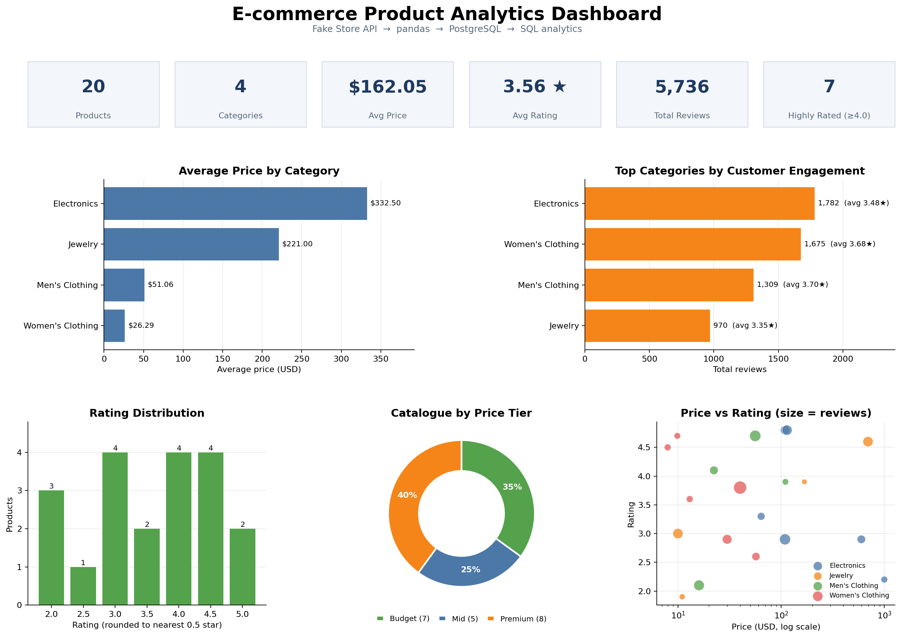
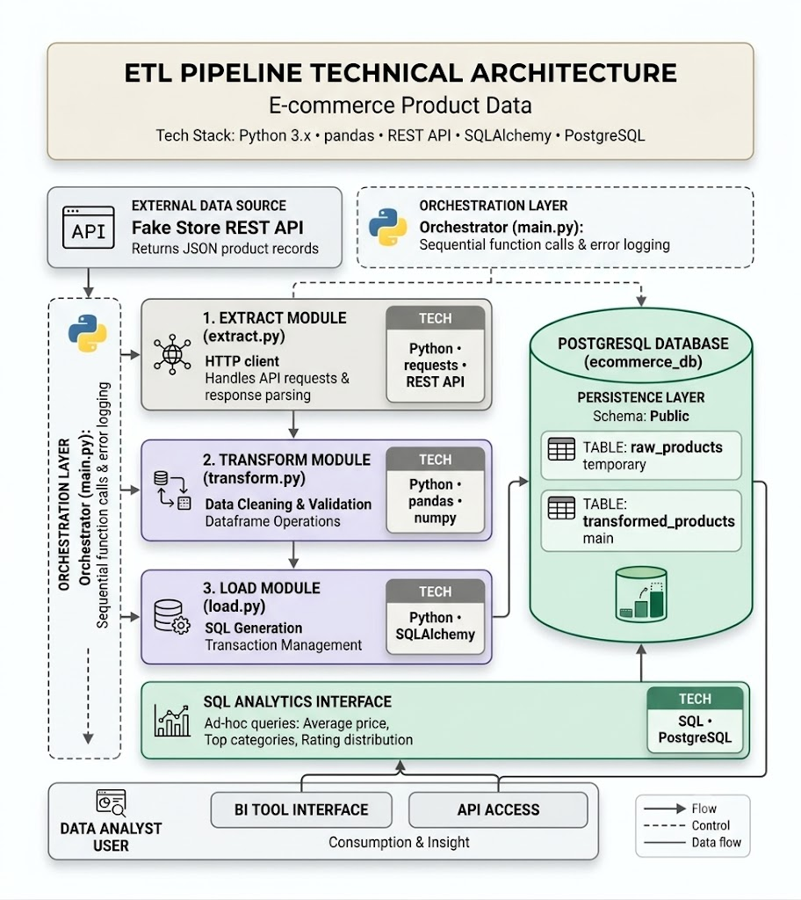
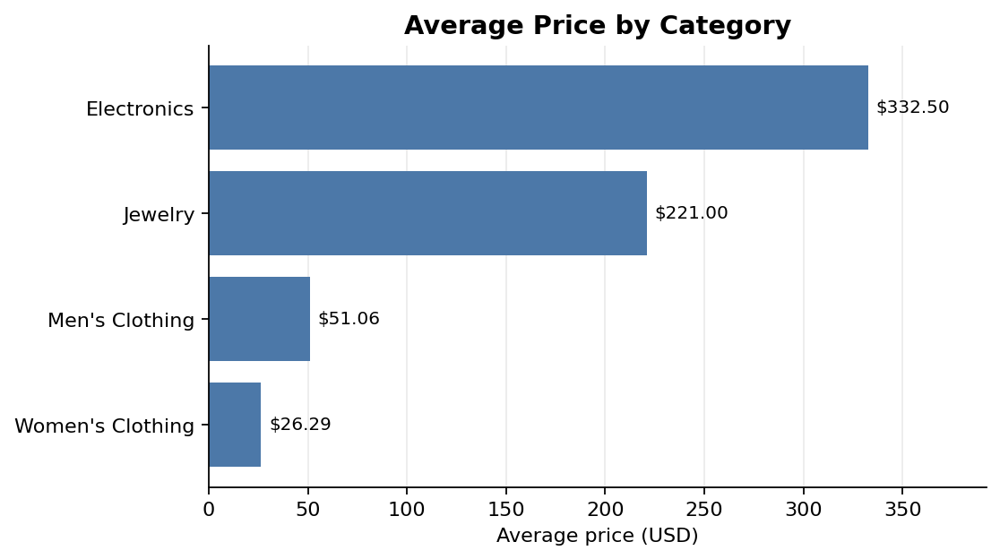
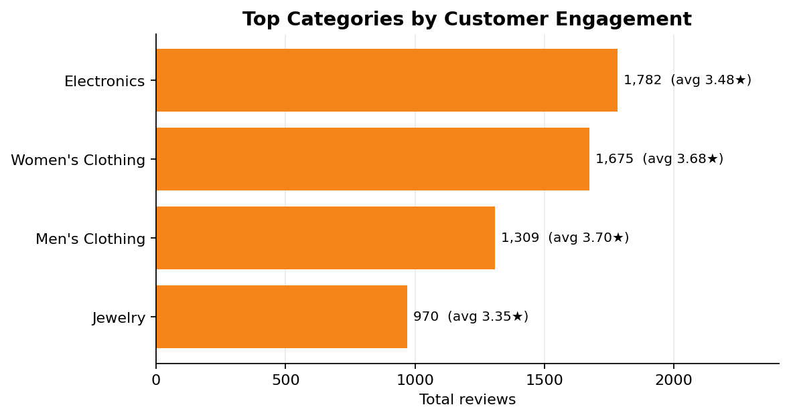
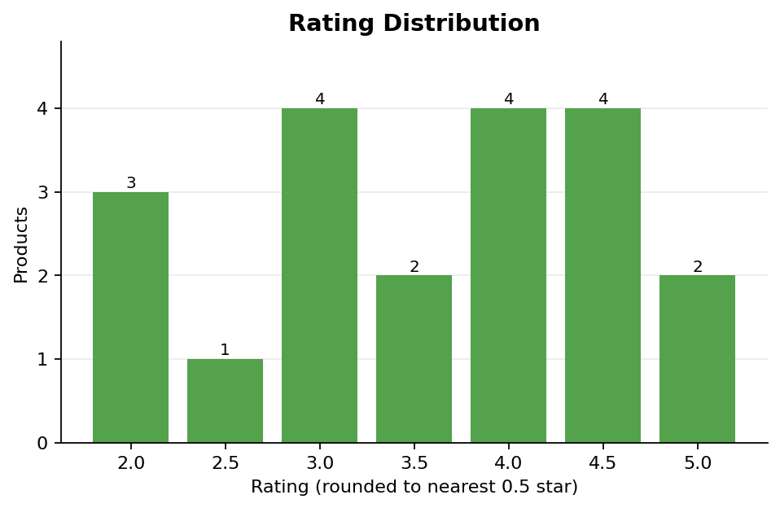
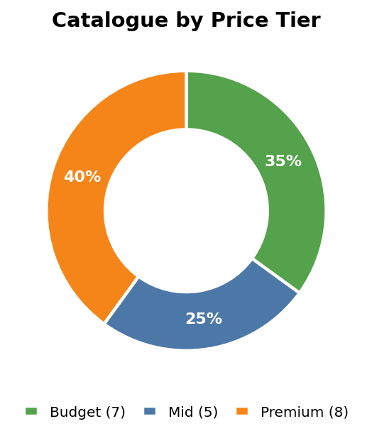
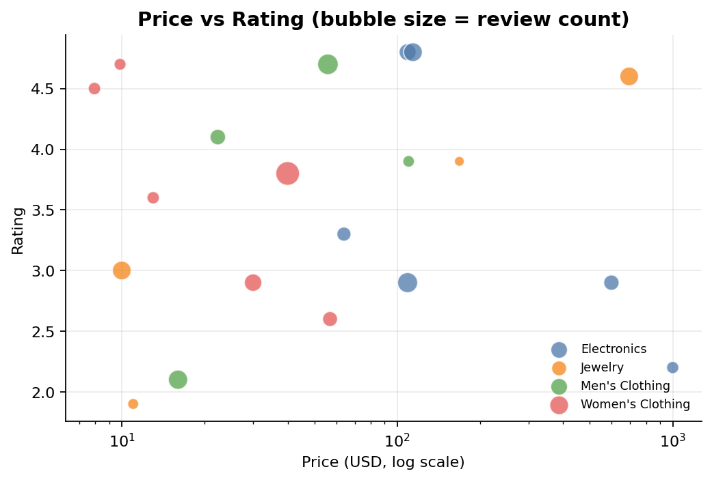

# 🛒 E-commerce Product Data ETL Pipeline

[](https://github.com/<your-username>/ecommerce-etl-pipeline/actions)


A modular, production-style **ETL pipeline** that extracts product data from a REST API, cleans and validates it with **pandas**, loads it into **PostgreSQL** using **SQLAlchemy**, and exposes a **SQL analytics layer** with auto-generated charts.



## 🏗️ Architecture



| Layer | File | Responsibility |
|---|---|---|
| Orchestration | `main.py` | Runs stages sequentially, times each one, logs errors, records every run in `pipeline_runs` |
| 1. Extract | `etl/extract.py` | HTTP client with retries + exponential backoff, payload validation, raw JSON snapshot |
| 2. Transform | `etl/transform.py` | Type coercion, text normalisation, validation rules, quarantine, de-duplication, feature engineering |
| 3. Load | `etl/load.py` | Idempotent **UPSERT** (`ON CONFLICT`), single atomic transaction, staging table, audit tables |
| Analytics | `sql/analytics_queries.sql`, `etl/analytics.py` | 10 analytical SQL queries (window functions, CTE-style ranking, joins on views) → CSV + charts |

## ✨ Engineering highlights

- **Idempotent loads** – re-running the pipeline never duplicates data (`INSERT … ON CONFLICT DO UPDATE`).
- **Atomic transactions** – staging + main-table writes commit together or roll back together.
- **Data-quality quarantine** – invalid rows are *not* silently dropped; they're stored in `rejected_products` with a reason (`invalid_price`, `missing_title`, `duplicate_id`, …).
- **Resilient extraction** – automatic retries with backoff on 429/5xx, timeouts, schema sanity check.
- **Observability** – structured logging (console + rotating file) and a `pipeline_runs` audit table (status, row counts, error message).
- **Feature engineering** – `price_tier`, `popularity_score = rating × log10(1 + reviews)`, `is_highly_rated`, `description_length`.
- **Tested** – 20 pytest tests (unit + integration + failure path); CI runs them plus a real-PostgreSQL smoke run.
- **Reproducible** – Docker Compose for the database, `.env` config, offline sample-data mode.

## 🗄️ Data model

```
raw_products           temporary staging snapshot (all TEXT, reloaded each run)
transformed_products   main table, PK = id, indexed on category
rejected_products      quarantined records + rejection reason
pipeline_runs          one row per execution (status, rows extracted/loaded/rejected)
vw_category_summary    view: products, avg price, avg rating, total reviews per category
vw_price_tier_summary  view: products & avg rating per price tier
```
Full DDL: [`sql/schema.sql`](sql/schema.sql)

## 🚀 Quick start

```bash
git clone https://github.com/<your-username>/ecommerce-etl-pipeline.git
cd ecommerce-etl-pipeline
python -m venv .venv && source .venv/bin/activate      # Windows: .venv\Scripts\activate
pip install -r requirements.txt
cp .env.example .env                                   # Windows: copy .env.example .env

docker compose up -d                                   # start PostgreSQL
python main.py                                         # run against the live Fake Store API
python main.py --offline                               # or use bundled sample data (no internet)
python -m pytest -v                                    # run the tests
```
No Docker? Install PostgreSQL locally and edit `DATABASE_URL` in `.env`, or try it instantly with SQLite:
`python main.py --offline --db-url sqlite:///demo.db`

Outputs after a run: `docs/charts/*.png` (charts), `reports/*.csv` (query results), `logs/etl.log`.

## 📊 SQL analytics examples

```sql
-- Best product in each category (window function)
SELECT category, title, popularity_score
FROM (SELECT category, title, popularity_score,
             ROW_NUMBER() OVER (PARTITION BY category ORDER BY popularity_score DESC) AS rn
      FROM transformed_products) t
WHERE rn = 1;

-- "Underrated gems": highly rated, well reviewed, cheaper than their category average
SELECT t.title, t.category, t.price, t.rating_rate
FROM transformed_products t
JOIN vw_category_summary c ON c.category = t.category
WHERE t.rating_rate >= 4.0 AND t.rating_count >= 100 AND t.price < c.avg_price;
```
All 10 queries live in [`sql/analytics_queries.sql`](sql/analytics_queries.sql).

### Sample insights (bundled 20-product sample dataset)

| Insight | Result |
|---|---|
| Most expensive category (avg price) | Electronics – $332.50 |
| Highest-engagement category | Electronics – 1,782 reviews |
| Best-rated category on average | Men's clothing – 3.70★ |
| Price tier with best avg rating | Premium – 3.75★ |
| "Underrated gems" found | 5 products (e.g. Silicon Power 256GB SSD, 4.8★ at $109) |

| | |
|---|---|
|  |  |
|  |  |
|  | |

> Charts in this repo were generated from the bundled sample data. Run `python main.py` with internet access to regenerate them from the live API.

## 📁 Project structure

```
├── main.py                  # orchestrator / CLI
├── etl/
│   ├── config.py            # settings from env
│   ├── logger.py            # logging setup
│   ├── extract.py           # stage 1
│   ├── transform.py         # stage 2
│   ├── load.py              # stage 3 (+ schema, views, run audit)
│   └── analytics.py         # SQL runner + charts
├── sql/                     # schema.sql, analytics_queries.sql
├── tests/                   # pytest suite
├── data/sample/             # offline sample dataset
├── docs/                    # architecture diagram + charts
├── reports/                 # CSV exports of query results
├── docker-compose.yml
└── .github/workflows/ci.yml
```

## 🔧 Design decisions

- **Why UPSERT instead of truncate-and-reload?** Preserves history of `loaded_at`, is safe to re-run, and scales to incremental loads.
- **Why a staging table?** Keeps an untouched copy of what the API returned for debugging and reconciliation.
- **Why quarantine rejected rows?** Silent drops hide data-quality problems; storing reasons makes them measurable.
- **Why log to a `pipeline_runs` table?** Gives a queryable run history, the same idea used by orchestrators like Airflow.

## 🛣️ Roadmap

- Schedule with Apache Airflow / cron
- Incremental extraction + SCD Type 2 for price history
- Great Expectations data-quality suite
- Dockerise the pipeline itself; deploy on AWS (RDS + Lambda/ECS)
- Connect Metabase / Power BI to the analytics views

## 📄 License
MIT
